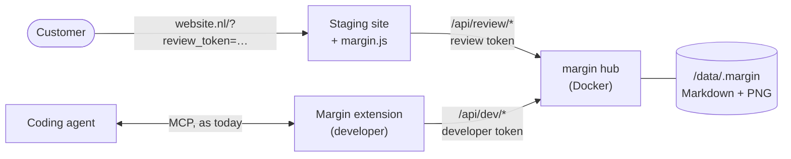

# Margin review hub

A small server that runs next to your **staging site** in Docker. Customers leave
feedback through a personal link; developers pull it with a developer token.
Each comment is stored as Markdown with its screenshots, on a volume you own.

> **Status:** the hub works on its own (API, tokens, storage, Docker image). Two
> pieces that use it are still being built: the overlay that customers see on
> the staging site (`margin.js`), and the projects in the Margin extension that
> pull from the hub. See [docs/hub-plan.md](../docs/hub-plan.md).



## Run it

1. **Build the image** from the `browser-review/` folder:

   ```sh
   docker build -f hub/Dockerfile -t margin-hub:1.2.0 .
   ```

2. **Add it to your staging `docker-compose.yml`** (see [docker-compose.example.yml](docker-compose.example.yml)):

   ```yaml
   services:
     margin:
       image: margin-hub:1.2.0
       restart: unless-stopped
       environment:
         MARGIN_PROJECT: acme-shop
         MARGIN_ORIGIN: https://staging.acme.com
       volumes:
         - margin-data:/data
   volumes:
     margin-data:
   ```

3. **Route one path to it** in the web server you already have, so it lives on
   the staging domain (no CORS, no extra certificate):

   ```nginx
   location /__margin/ {
     proxy_pass http://margin:4780/;
     client_max_body_size 16m;   # comments carry screenshots
   }
   ```

   Caddy: `handle_path /__margin/* { reverse_proxy margin:4780 }`

## Tokens

Tokens are managed only from inside the container: there is no admin API on
the network.

```sh
docker compose exec margin margin token add --reviewer "Anna (client)" --expires 30
#   → https://staging.acme.com/?review_token=mrev_…   (send this link to Anna)
docker compose exec margin margin token add --developer "Andor"
#   → mdev_…                                          (paste into the Margin extension)
docker compose exec margin margin token list
docker compose exec margin margin token revoke "Anna (client)"
```

- **Review tokens** (`mrev_`) can create comments, reply, accept, reopen, and
  delete their own open comments. They only work from `MARGIN_ORIGIN`, for pages
  on that site, and at most `MARGIN_COMMENTS_PER_HOUR` (60) new comments per hour.
- **Developer tokens** (`mdev_`) can read everything and set *in progress* and
  *review ready*. They are refused when sent from a web page.
- Every token has a name, which goes on each message it writes. Only a SHA-256
  hash is stored, the token is shown once, and a revoke works right away.

## Where the data lives

```
/data/.margin/
  comments/0012.json     the comment (source of truth)
  feedback/0012.md       the same comment as Markdown, rewritten on every change
  feedback/0012-7.png    its screenshots
  tokens.json            token names and hashes (written by the CLI only)
  token-usage.json, counters.json, deletions.json
```

The Markdown is what an agent gets from `get_comment`, with frontmatter
(status, page, reviewers) and links to the images. Back up the volume like any
other data. It is never served by the web server: the hub only hands out data
to valid tokens.

## Environment

| Variable | Default | |
|---|---|---|
| `MARGIN_PROJECT` | required | Project name, shown in the Margin extension |
| `MARGIN_ORIGIN` | required | The staging site; review links only work there |
| `MARGIN_DATA` | `/data/.margin` | Data folder, a volume outside the webroot |
| `PORT` | `4780` | |
| `MARGIN_COMMENTS_PER_HOUR` | `60` | New comments per review token per hour |

## API

| | Token | |
|---|---|---|
| `GET /api/review/comments` | review | All comments of the project |
| `POST /api/review/comments` | review | New comment (`CreateCommentInput`, up to 15 MB with screenshots) |
| `GET /api/review/comments/:id` | review | One comment |
| `POST /api/review/comments/:id/reply` `{ body }` | review | |
| `POST /api/review/comments/:id/accept` | review | |
| `POST /api/review/comments/:id/reopen` `{ body? }` | review | |
| `DELETE /api/review/comments/:id` | review | Own comments, while open (or as the sidebar allows) |
| `GET /api/review/screenshots/:id` | review | `{ dataUrl }` |
| `GET /api/dev/project` | developer | `{ name, origin, version, you }` |
| `GET /api/dev/comments?since=&status=` | developer | `{ comments, deleted, now }`: pass `now` as the next `since` |
| `GET /api/dev/comments/:id` | developer | |
| `POST /api/dev/comments/:id/start_work` | developer | |
| `POST /api/dev/comments/:id/reply` `{ message }` | developer | |
| `POST /api/dev/comments/:id/submit_solution` `{ note, files? }` | developer | |
| `GET /api/dev/screenshots/:id` | developer | `{ dataUrl }` |
| `GET /margin.js`, `/margin-<version>.js` | – | The staging overlay (once built); `margin sri` prints the tags |
| `GET /help`, `/healthz` | – | |

Errors are JSON `{ error }` with 400, 401, 403, 404, 409 (not allowed in this
status), 413, 415 or 429.

## Develop

```sh
pnpm --dir hub test        # storage, tokens and the API against a real server
pnpm --dir hub build       # dist/hub.js, one file without dependencies
MARGIN_PROJECT=demo MARGIN_ORIGIN=http://localhost:5173 MARGIN_DATA=./.margin-dev pnpm --dir hub start
```
