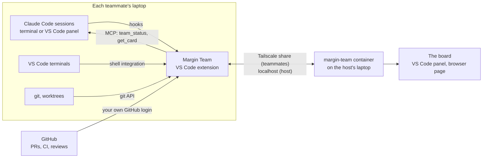

# Margin Team

> **Status: idea.** Nothing is built yet. [`prototype/`](prototype/) is a clickable mockup
> in three pages (open `index.html` in a browser; the activity is simulated):
> [the board](prototype/index.html), [getting started](prototype/start.html) and
> [how it looks in VS Code](prototype/vscode.html).

A live kanban board for a team that builds together, like at a hackathon. It fills
itself from **git, your terminals, your Claude Code sessions and GitHub**, so everyone
can see who is building what, on which branch, and what their agents are doing right
now. Your own Claude sees the same board, so you never have to tell it "Zeb is doing
the login, Sam has the API" again.

It doesn't replace talking to each other. It replaces repeating yourself.

## Why

At a hackathon four people each run one or more agents in the same repo. Nobody has
time to keep a board up to date, so either there is no board, or it's a lie by
lunchtime. Meanwhile everyone keeps asking, and keeps telling their agent:

- "Which branch is the login on?"
- "Is Sam's endpoint done yet? Can I hook it up?"
- "Don't touch the navbar, Zeb is fixing it."

Margin Team answers those from what's actually happening, and keeps the board honest
by moving the cards itself.

## The board

Four columns. A card moves by itself when its branch does:

| Column | A card is here when |
|---|---|
| **Up next** | it has no branch yet |
| **Building** | its branch exists and has commits or a running agent |
| **In review** | its branch has an open pull request |
| **Shipped** | the pull request is merged |

You can still drag a card, add one by hand or edit its title. A card is linked to a
branch, and the branch is what moves it.

What a card shows:

- the title, the owner and the **branch** (with commits ahead of `main`)
- the **agents** working on it: working (pulsing), waiting for their human, or idle,
  with a one-line "what it's doing now" (`editing src/auth/google.ts`)
- **local CI**: passed, or failed and the push is held (see [Local CI first](#local-ci-first))
- the **terminals** that matter, like a running dev server
- the **pull request**: number, GitHub CI status, reviews

At the top, a strip with each person: their current branch and their agents. At the
side, a live feed ("Sam's Claude is waiting for Sam", "PR #12: CI failed on lint").

## Where the data comes from

Everything is collected by a **VS Code extension** on each teammate's machine. It's
the only place that sees all four sources:

| Source | How | What it gives |
|---|---|---|
| **Git** | VS Code's built-in git extension API | branches (also in worktrees), commits ahead, uncommitted changes |
| **Terminals** | VS Code shell integration (`onDidStartTerminalShellExecution`) | which command runs where, and whether it passed or failed |
| **Claude Code** | Claude Code hooks that report to the extension on the same machine | each session's task, state and touched files, in the terminal and in the Claude Code panel |
| **GitHub** | the GitHub API, using the GitHub login VS Code already has | pull requests per branch, CI checks, reviews, merges |

An agent belongs to the card whose branch its working directory is on. With
worktrees, one person can have agents on several cards at once.

The Claude Code hooks:

| Hook | Sends |
|---|---|
| `SessionStart` | a new session, its working directory and branch |
| `UserPromptSubmit` | state: working, and the task (see below) |
| `PreToolUse` (Bash) | before a `git push`: runs local CI, and holds the push when a check fails |
| `PostToolUse` (Edit, Write, Bash) | touched files, branch switches, commits |
| `Notification` | state: waiting for its human |
| `Stop` | state: idle |

## AI on the board

- **Cards from sessions.** When you start a Claude session on a new branch, the board
  makes a card for it. Claude writes the title from your first prompt ("Google sign-in
  on the login page", not your whole prompt).
- **One-line status.** Each agent's "doing now" line comes from its last tool call,
  so it costs no tokens. Claude can rewrite the card's summary when the task changes.
- **Ask the board.** "What's blocking the demo?", "Who touched the auth code?",
  "Catch me up on the last hour." Answered from the board's own data.
- **Suggested cards.** TODOs that agents add, or work an agent says it left for later,
  show up dashed in *Up next*. One click makes them real cards.
- **What your Claude sees.** At session start, a short snapshot of the board. On each
  prompt, only what changed since the last one. Plus MCP tools:
  - `team_status`: people, branches, agents, PRs
  - `get_card`: one card with its files, commits and checks
  - `link_card`: link this session to a card (when the board guessed wrong)

  So "hook the scoreboard up to Sam's endpoint" just works: Claude knows the branch,
  the files and that PR #13 is green.

## Local CI first

Nothing gets pushed before the repo's CI checks pass on the laptop that pushes. GitHub CI
becomes the confirmation, not the place you find out. At a hackathon the Actions queue is
slow and every red PR costs minutes, and with several agents pushing, a broken branch
blocks whoever builds on it.

- **The checks** come from the GitHub workflow: the extension reads
  `.github/workflows/*.yml`, proposes the commands it finds (`pnpm typecheck`, `pnpm test`,
  `pnpm build`), and one person confirms them. They're saved in `margin-team.json` in the
  repo, so everyone runs the same ones.
- **Claude's pushes:** a `PreToolUse` hook catches `git push`, runs the checks first and
  holds the push when one fails. Claude gets the failing check and the first lines of the
  error back, fixes it and pushes again. A result is reused when nothing changed since.
- **Your own pushes:** a git `pre-push` hook does the same. `"beforePush": "warn"` makes
  it only warn, for teams that want that.
- **On the board:** each card shows *local ✓*, *local ✓ · ready to push* or
  *local ✗ test · push held*, apart from GitHub CI. "What's blocking the demo?" lists
  held pushes too.

Only the result is shared (which check, passed or failed). The output stays on the laptop,
and only Claude on that laptop sees the error it has to fix.

## What is never shared

- Your prompts, Claude's answers and transcripts. Only the one-line task and the
  "doing now" line.
- Terminal output. Only the command and whether it passed.
- File contents and diffs. Only paths, and commits as GitHub shows them.
- Anything from a session you pause (`/margin pause`) or a folder outside the repo.

## How it fits together



The MCP side works like Browser Review: Claude Code starts a small MCP server per
session, it talks to the extension on the same machine, and stores nothing itself.

## Setup at a hackathon (planned)

Everyone needs **Tailscale** with their own free account. The host also needs
**Docker**. Margin ships no networking code: the connection is Tailscale's.

1. Everyone installs Tailscale and the extension.
2. **The host** runs `Margin Team: Start a team`. Margin starts the board in a Docker
   container, `margin-team`, with Tailscale inside it, and the host opens it at
   `http://localhost:4780`.
3. **The host, first time:** clicks the Tailscale login link the container shows. The
   container is now a machine in the host's tailnet, `margin-andor`.
4. **The host** shares that container (not their laptop) with the teammates in Tailscale.
5. **Everyone else** accepts the share and runs `Margin Team: Join team`. Tailscale tells
   the board who is connecting; the host allows each teammate once.
6. The extension offers to add the Claude Code hooks and the MCP server. One click.
7. The host confirms the local CI checks the extension found in the GitHub workflow.
8. Optional: put the board on the big screen: `http://localhost:4780` on the host's
   laptop, `https://margin-andor.<tailnet>.ts.net:4780` on a teammate's.

[Get started](prototype/start.html) shows each step and a network diagram.

## Network and security

**The host never shares their laptop.** The board runs in its own Docker container,
which joins the host's tailnet as a separate machine, and only that container is
shared with the teammates ([Tailscale sharing](https://tailscale.com/docs/features/sharing)).
A wrong or forgotten setting can't expose anyone's laptop: the worst case is that the
board doesn't work.

```sh
docker run -d --name margin-team \
  -p 127.0.0.1:4780:4780 \
  -v margin-team:/var/lib/margin \
  ghcr.io/margin/team
```

- **The host reaches it on localhost.** Docker publishes the port on `127.0.0.1` only
  (Docker's default would be every interface, so this matters). The board never shows up
  on the venue Wi-Fi.
- **Teammates reach it through Tailscale.** Inside the container, `tailscale serve`
  makes the board available over HTTPS on port 4780. Nothing else runs in the container,
  so even Tailscale's default "everyone can reach everything" policy only reaches the
  board. **No policy changes** for the host.
- **No way back into the host's tailnet.** Tailscale runs in userspace mode in the
  container ([the image's default](https://tailscale.com/docs/features/containers/docker/docker-params)).
  Then programs in the container can only reach the tailnet through a SOCKS5/HTTP proxy
  ([userspace networking](https://tailscale.com/docs/concepts/userspace-networking)),
  and the image doesn't turn one on. Even a bug in the team server would leave an
  attacker in an empty container, not at the host's NAS.
- **One way only.** Tailscale quarantines shared machines: they accept connections but
  can't start any, so the container can't reach the teammates' laptops.
- **Teammates' tailnets don't change.** Accepting a share adds one machine to their own
  tailnet. They stay connected to their personal or work tailnet, and their devices stay
  invisible to the host.
- **Who is who.** Teammates come in through `tailscale serve`, which adds
  `Tailscale-User-Login` to every request
  ([Tailscale Serve](https://tailscale.com/docs/features/tailscale-serve)). The host's
  extension started the container and holds a host key. The board rejects requests that
  have neither.
- **The container is a normal machine of the host**, not a tagged one, because Tailscale
  can only share machines that users own. Its identity lives in the Docker volume, so it
  reconnects by itself next time.
- **What Tailscale sees:** keys and addresses, never the board. Traffic is WireGuard,
  encrypted between the devices, through a Tailscale relay over port 443 when a direct
  connection fails. The remaining trust point is Tailscale's coordination server;
  Tailnet Lock or a self-hosted Headscale removes it.
- **Company tailnets:** admins may not allow accepting shares. Then join with a
  personal account.
- **Safety nets:** Margin warns when the host's laptop itself is shared, and a
  teammate's extension tries a few common ports on the shared machine when joining and
  reports anything other than 4780 that answers.

Two rules don't depend on the network:

- **Board text is untrusted input** for everyone's Claude. It reaches Claude as clearly
  marked data with short fields, only through the hooks and the MCP tools.
- **Nothing from the network is ever run.** Local CI checks come only from
  `margin-team.json` in git, never from a peer.

Considered and dropped:

- **Sharing the host's laptop** with `tailscale serve` on it: one wrong setting in the
  tailnet policy exposes every open port on the laptop to the teammates.
- **Shipping our own Tailscale helper** (tsnet): native networking code on everyone's
  laptop, ours to secure and sign.
- **Hyperswarm or our own encrypted relay:** no account needed, but we'd build and run
  it ourselves. An encrypted relay could come later for teams that can't use Tailscale.

## Build order

1. VS Code extension: git and Claude hooks, a team over Tailscale invites, the board in a
   VS Code panel. This alone answers "who is on which branch, and what are their
   agents doing".
2. Pull requests and CI from GitHub, and cards moving by themselves.
3. Local CI before every push: the checks from the workflow, the push hooks, the status
   on the cards.
4. Terminals.
5. What Claude sees: the snapshot, the changes per prompt, the MCP tools.
6. The AI parts: titles from prompts, Ask the board, suggested cards.

## Open questions

- **Automating the share.** Can the extension create the share invites through
  Tailscale's API, or does the host click them in the admin console? And how does the
  free plan count shared users?
- **The host leaves.** The container on the host's laptop keeps the board. If that
  laptop closes, the team is offline. Hand the board over, or run the container on a
  small server instead (it's just a Docker image)?
- **Where the board lives.** A VS Code panel, a browser page, or both? The prototype is
  a browser page because that's what goes on the big screen.
- **Other editors.** Cursor and Windsurf can install it from Open VSX. Claude running
  outside VS Code still reports through its hooks; it just has no terminal info.
- **Long checks.** A build of several minutes makes every push slow. Run only the fast
  checks before a push and leave the rest to GitHub CI? Or run them in the background
  after each commit, so the result is ready when Claude pushes?
- **Beyond hackathons.** Does the same board work for a team over weeks? Then it needs
  history, and could share the hub with [Browser Review](../browser-review/), whose
  comments could show up on the card for the page they're on.
